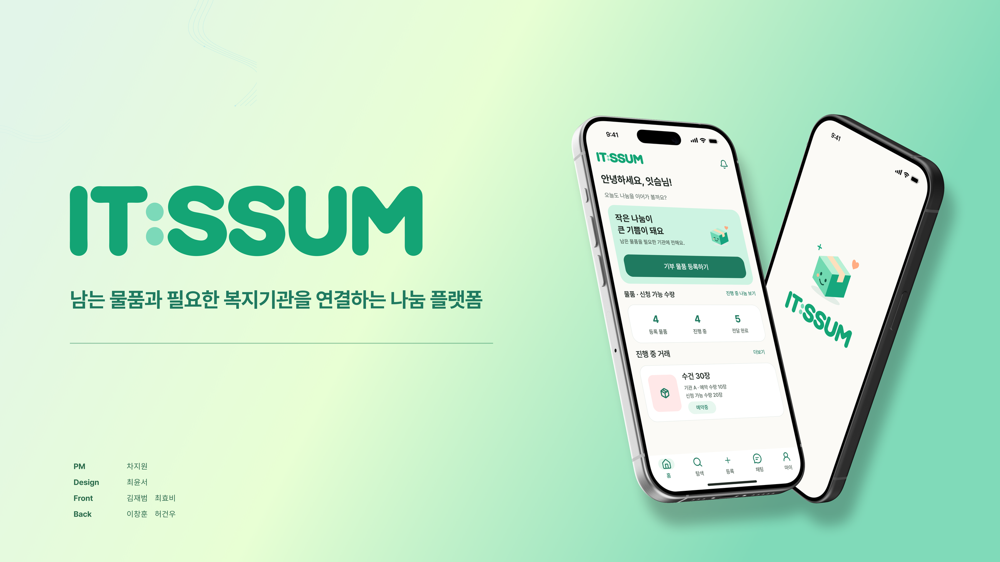
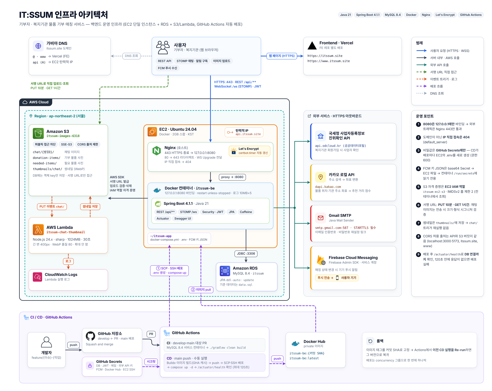
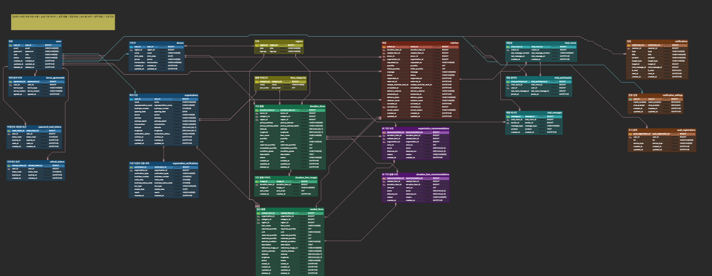

# ♾️ IT:SSUM

### 버려질 자원을 가장 필요한 곳으로,
### 남는 물품과 필요한 복지기관을 연결하는 나눔 플랫폼


---

## ✨ 프로젝트 소개

IT:SSUM은 쓰지 않는 물품을 그 물품이 실제로 필요한 복지기관에 연결하는 양방향 물품 기부 플랫폼입니다.
기부의 양보다 적합성에 집중해, 아직 쓸 수 있는 물품이 버려지기 전에 필요한 곳에서 다시 쓰이도록 돕습니다.

- **기간** : 2026.10.13 ~ 2026.11.18
- **인원** : Backend 2명
- **목표** : 기관의 수요와 기부 물품을 구조화하고 설명 가능한 추천으로 연결해, 기부처 탐색 부담을 줄이고 수령 확인까지 실제 재사용으로 이어지게 하는 것
- **핵심 흐름** : 기부·필요 물품 등록 → 추천 기관 확인 → 기부 제안·요청 → 수락 후 채팅 협의 → 수량 예약 → 수령 확인·전달 완료
- **서비스 URL** : [https://itssum.site](https://itssum.site)

---

## 🧑🏻‍💻 팀원 및 역할

|                [이창훈](https://github.com/Chhun-Lee)                 |               [허건우](https://github.com/woo6629058)                |
|:-----------------------------------------------------------------:|:-----------------------------------------------------------------:|
|  |  |
|           인증·회원·물품·추천·인프라            |                         매칭·채팅·알림                          |

---

## 🚀 주요 기능

| 기능 | 설명 |
| --- | --- |
| 인증·회원 | 이메일 인증, JWT 로그인·토큰 재발급, 기부자·복지기관 회원가입, 회원 탈퇴 |
| 기관 인증 | 국세청 사업자등록정보 진위확인 API로 가입 시 사업자 확인 |
| 물품 | 기부 물품·필요 물품 등록·수정·삭제, 검색어·카테고리·지역·상태 필터 탐색, 필요 물품 모집 종료 |
| 기관 추천 | 기부 물품 기준 규칙 기반 추천 (수량 적합도·거리 점수), 추천 이유 제공 |
| 매칭 | 기부 제안·요청, 수락·거절·철회, 합의 수량 변경, 수량 예약, 전달 약속, 수령 확인, 취소 |
| 채팅 | STOMP 기반 1:1 채팅, 이미지 메시지와 썸네일, 읽음 처리, 전달 약속 카드 |
| 알림 | 매칭 상태 변경 알림, 실시간 구독, FCM 푸시, 알림 설정 |
| 파일 | S3 Presigned URL 기반 물품·채팅 이미지 직접 업로드 |

---

## 🧩 핵심 기술 및 설계

### 1. 설명 가능한 규칙 기반 기관 추천

- 학습 데이터가 없는 초기 서비스에서도 바로 동작하도록, 필수 조건으로 후보를 거른 뒤 점수로 순위를 매기는 방식으로 구현
- 필수 조건: 같은 카테고리·단위, 기관 희망 상태 이상, 인증된 기관, 모집 중
- 총점 = 100 × (0.6 × 수량 적합도 + 0.4 × 거리 점수). 거리는 하버사인 공식, 20km 기준
- 카카오 로컬 API로 주소를 좌표로 바꿔 거리를 계산하고, 변환에 실패하면 등록은 유지한 채 거리 점수만 0으로 처리
- 상위 3개 기관과 함께 충족한 조건·지원 가능 수량·거리를 추천 이유로 제공해, 기부자가 근거를 보고 직접 선택

### 2. 상태 머신 기반 매칭과 단계별 수량 확보

- 물품을 여러 기관에 나눠 줄 수 있도록 수량을 전체·예약·완료로 분리해 관리
- `PENDING → TRADING → RESERVED → COMPLETED` 전이를 엔티티 메서드로만 허용하고, 단계마다 행동할 수 있는 주체를 검증
- 수락만으로는 수량을 잡지 않고 기부자가 예약할 때 양쪽 물품에 반영하며, 완료 시 완료 수량으로 옮기고 예약 중 취소 시 되돌림

### 3. 비관적 락으로 수량 초과 예약 방지

- 여러 거래가 같은 물품을 동시에 예약하면 신청 가능 수량을 넘을 수 있음
- 예약·완료·취소 시 매칭과 기부·필요 물품 행을 `PESSIMISTIC_WRITE`로 잠그고, 항상 같은 순서로 조회해 데드락 방지
- 잠근 상태에서 신청 가능 수량을 다시 검사해 동시 요청에도 수량을 넘지 않도록 보장

### 4. 커밋 이후 전송하는 채팅·알림

- 수락된 거래 1건마다 채팅방 1개를 열고, 거래가 끝나면 읽기 전용으로 전환
- 메시지와 알림은 DB 커밋 후(`AFTER_COMMIT`)에만 WebSocket·FCM으로 전송해, 롤백된 데이터가 전달되지 않게 함
- 푸시 실패가 거래 처리에 영향을 주지 않도록 분리하고, 만료된 기기 토큰은 별도 트랜잭션에서 자동 정리
- 전달 예정 시각이 지난 예약 건은 스케줄러가 찾아 수령 확인 알림을 한 번만 발송

### 5. 서명 URL 기반 이미지 업로드

- 비공개 S3에 서버가 발급한 서명 URL로 직접 업로드·조회하고, DB에는 객체 key만 저장
- 업로드 후 파일 앞부분 시그니처(JPEG·PNG·WebP)를 검사해 확장자만 바꾼 위장 파일을 거절
- 채팅 이미지는 S3 이벤트로 Lambda가 WebP 썸네일을 생성

---

## 🛠 기술 스택

| 구분 | 기술 |
| --- | --- |
| Backend | Java 21, Spring Boot 4.1.1, Spring MVC, Gradle |
| Data | Spring Data JPA (Hibernate), MySQL 8.4, Caffeine |
| Security | Spring Security, JWT (OAuth2 Resource Server) |
| Realtime | Spring WebSocket, STOMP |
| External | 국세청 사업자등록정보 진위확인 API, 카카오 로컬 API, Gmail SMTP, Firebase Cloud Messaging |
| Storage | Amazon S3 (Presigned URL), AWS Lambda (채팅 썸네일) |
| API Docs | Swagger UI, springdoc-openapi |
| Test | JUnit 5, Spring Boot Test, Spring Security Test |
| Infra | AWS EC2, RDS, S3, Lambda, Docker, Docker Hub, Nginx, Let's Encrypt, GitHub Actions |

---

## 🏗 시스템 아키텍처



---

## 🗃 ERD



---

## 📡 API 구성

| 구분 | 주요 경로 | 기능 |
| --- | --- | --- |
| 인증 | `/api/auth/**` | 이메일 인증, 기부자·기관 가입, 사업자 확인, 로그인, 로그아웃, 토큰 재발급 |
| 회원 | `/api/users/me`, `/api/donors/**`, `/api/organizations/**` | 내 정보 조회·수정, 기관 조회, 회원 탈퇴 |
| 기준 데이터 | `/api/item-categories`, `/api/item-units`, `/api/item-conditions` | 카테고리, 단위, 물품 상태 |
| 기부 물품 | `/api/donation-items/**`, `/api/donors/me/donation-items` | 등록, 탐색, 상세, 수정, 삭제, 사진 업로드 URL |
| 필요 물품 | `/api/needed-items/**`, `/api/organizations/me/needed-items` | 등록, 탐색, 상세, 수정, 삭제, 모집 종료, 사진 업로드 URL |
| 추천 | `/api/donation-items/{donationItemId}/recommendations` | 추천 기관 생성·조회 |
| 매칭 | `/api/matches/**` | 제안·요청, 목록·상세, 수락·거절·철회, 수량 변경, 예약, 전달 약속, 수령 확인, 취소 |
| 채팅 | `/api/chat-rooms/**`, `/ws` | 채팅방 목록, 메시지 조회, 읽음 처리, 이미지 업로드 URL, STOMP 메시지 전송 |
| 알림 | `/api/notifications/**`, `/api/users/me/notification-settings`, `/api/users/me/push-registrations` | 알림 목록, 안 읽은 개수, 읽음 처리, 알림 설정, FCM 기기 등록 |

- Swagger UI (운영): [https://api.itssum.site/swagger-ui.html](https://api.itssum.site/swagger-ui.html)
- Swagger UI (로컬): [http://localhost:8080/swagger-ui.html](http://localhost:8080/swagger-ui.html)
- WebSocket: 연결 `/ws`, 채팅 구독 `/topic/chat-rooms/{chatRoomId}`, 전송 `/app/chat-rooms/{chatRoomId}/messages`, 알림 구독 `/user/queue/notifications`

---

## 📁 프로젝트 구성

```text
src/main/java/com/itssum
├── domain
│   ├── auth            # 로그인, 회원가입, 이메일 인증, 토큰
│   ├── user            # 회원, 기부자, 복지기관, 약관 동의, 사업자 인증 이력
│   ├── item            # 기부 물품, 필요 물품, 이미지, 카테고리, 지역
│   ├── recommendation  # 기관 추천 (규칙 기반 점수 계산과 결과)
│   ├── match           # 매칭
│   ├── chat            # 채팅방, 참여자, 메시지, 채팅 이미지
│   └── notification    # 알림, 알림 설정, 푸시 등록
└── global
    ├── common          # BaseTimeEntity, ApiResponse
    ├── config          # JPA Auditing, Security, Swagger
    ├── exception       # ErrorCode, SuccessCode, BusinessException, GlobalExceptionHandler
    ├── security        # JWT 인증
    ├── validation      # 공통 검증 어노테이션
    └── infra           # S3, 국세청 사업자 API, 카카오 로컬, 메일, FCM
```

---

## 💻 로컬 실행 방법

### 요구 사항

- JDK 21
- MySQL 8.4

### 데이터베이스

```sql
CREATE DATABASE IF NOT EXISTS itssum
  CHARACTER SET utf8mb4
  COLLATE utf8mb4_unicode_ci;
```

스키마는 `spring.jpa.hibernate.ddl-auto: update`로 엔티티 기준으로 생성되고, 지역·카테고리 같은 기준 데이터는 `src/main/resources/data.sql`이 서버가 뜰 때 넣습니다.

### 환경변수

최소한 다음 값을 설정합니다. 비밀값은 저장소에 커밋하지 않습니다.

```bash
export DB_URL="jdbc:mysql://localhost:3306/itssum?serverTimezone=Asia/Seoul"
export DB_USERNAME=your_local_user
export DB_PASSWORD=your_local_password
export JWT_SECRET=32자_이상_무작위_문자열
```

외부 연동을 실제로 사용할 때만 다음 값을 추가합니다.

```bash
export MAIL_USERNAME=발신용@gmail.com      # Gmail SMTP (앱 비밀번호)
export MAIL_PASSWORD=앱비밀번호
export NTS_SERVICE_KEY=서비스키            # 국세청 사업자등록정보 진위확인 (공공데이터포털 디코딩 키)
export KAKAO_REST_API_KEY=REST키           # 카카오 로컬 (주소 → 좌표). 없으면 좌표 없이 저장
```

IntelliJ에서는 Run Configuration의 Environment variables에 같은 값을 등록합니다.

```bash
./gradlew bootRun
```

테스트:

```bash
./gradlew test
```

S3 설정은 운영 프로필(`application-prod.yml`)에만 있어 로컬에서는 이미지 업로드 API가 503을 반환합니다.

---

## 🔄 CI/CD

- `develop`·`main` 대상 Pull Request: MySQL 8.4 컨테이너 환경에서 Gradle 빌드·테스트
- `main` 반영: Docker 이미지 빌드 → Docker Hub Push (태그: 커밋 SHA)
- SSH로 EC2에 접속해 `.env` 생성 후 Docker Compose로 컨테이너 교체
- `/actuator/health`로 배포 결과 확인, 롤백은 이전 CD 실행 Re-run
- 비밀값은 GitHub Secrets로 관리하고, 배포 시 EC2의 `.env`를 새로 생성

---

## 🤝🏻 협업 규칙

- 기본 흐름: `작업 브랜치 → Pull Request → develop → main`
- 브랜치: `feature/{이슈번호}-{작업}`, `fix/{이슈번호}-{작업}`, `refactor/{이슈번호}-{작업}`, `docs/{이슈번호}-{작업}`, `chore/{이슈번호}-{작업}`
- 커밋: `타입: 작업 내용 (#이슈번호)` (`feat`, `fix`, `refactor`, `docs`, `test`, `chore`, `style`)
- PR은 `develop` 대상, 리뷰어 1명 승인 후 Squash and merge, 머지한 브랜치는 삭제
- PR에 작업 내용, 관련 이슈, 확인 방법과 테스트 결과 작성
- 민감 정보는 환경변수로 관리하고 저장소에 커밋하지 않음

자세한 규칙은 [`CONTRIBUTING.md`](CONTRIBUTING.md)를, PR 작성 양식은 [`.github/PULL_REQUEST_TEMPLATE.md`](.github/PULL_REQUEST_TEMPLATE.md)를 참고합니다.
