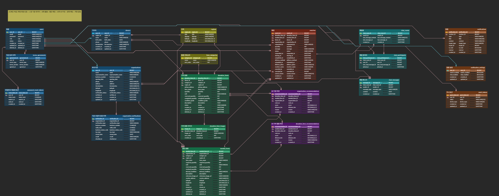

# IT:SSUM

기부자와 복지기관을 연결하는 물품 기부 매칭 서비스 IT:SSUM의 백엔드 레포지토리입니다.

기부자는 가지고 있는 물품을 올리고, 기관은 필요한 물품을 올립니다. 서로 맞는 상대를 추천받아 제안·요청을 주고받고, 수락되면 채팅으로 전달 일정을 잡아 기관이 수령 확인까지 하는 흐름입니다.

<br>

## 주요 기능

**기부자**
- 기부 물품 등록 (카테고리, 품목, 수량, 물품 상태 상·중·하, 사진 1장 이상, 구 단위 지역)
- 등록한 물품 기준으로 추천 기관 목록 확인 후 기부 제안
- 기관이 보낸 나눔 요청 수락 / 거절
- 수락된 건은 채팅으로 일정 조율 → "나눔중"으로 변경

**복지기관**
- 회원가입 시 국세청 사업자등록정보 진위확인 API로 사업자 확인 (운영자 승인 절차 없음)
- 필요 물품 등록 (필요 수량, 희망 최소 상태, 수령 지역)
- 필요 물품 기준으로 추천 기부 물품 확인 후 나눔 요청
- 물품을 받으면 수령 확인 → 전달 완료

**공통**
- STOMP 기반 1:1 채팅 (매칭 1건당 채팅방 1개)
- 매칭 상태가 바뀔 때마다 알림 (실시간 구독 + 목록 조회, 읽음 처리)
- 이메일 링크로 비밀번호 재설정

<br>

## 기술 스택

| 구분 | 사용 |
|---|---|
| Language | Java 21 |
| Framework | Spring Boot 4.1.1, Spring MVC |
| DB | MySQL 8.4, Spring Data JPA (Hibernate) |
| 인증 | Spring Security, JWT (OAuth2 Resource Server) |
| 실시간 | Spring WebSocket + STOMP |
| 기타 | Validation, Java Mail Sender (Gmail SMTP), Caffeine, Lombok |
| 외부 API | 국세청 사업자등록정보 진위확인 (공공데이터포털), 카카오 로컬 (주소 → 좌표) |
| Build | Gradle (Groovy) |
| 배포 | GitHub Actions, Docker, AWS EC2 · RDS |
| API 문서 | springdoc-openapi (Swagger UI) |
| 예정 | AWS S3 (이미지), FCM (푸시) |

<br>

## ERD




| 색 | 도메인 | 테이블 |
|---|---|---|
| 파랑 | 회원·인증 | `users`, `terms_agreements`, `password_reset_tokens`, `refresh_tokens`, `donors`, `organizations`, `organization_verifications` |
| 노랑 | 기준 데이터 | `regions`, `item_categories` |
| 초록 | 물품 | `donation_items`, `donation_item_images`, `needed_items` |
| 빨강 | 매칭 | `matches` |
| 보라 | AI 추천 | `organization_recommendations`, `donation_item_recommendations` |
| 청록 | 채팅 | `chat_rooms`, `chat_participants`, `chat_messages` |
| 주황 | 알림 | `notifications`, `notification_settings`, `push_tokens` |

설계하면서 정한 것들

- `donors`, `organizations`, `notification_settings`는 `users`의 PK를 그대로 PK로 씁니다. 엔티티에서는 `@MapsId`로 매핑합니다.
- 매칭은 항상 기부 물품 1개와 필요 물품 1개를 잇습니다. 기부자가 먼저 제안한 건지 기관이 먼저 요청한 건지는 `requested_by`로 구분합니다.
- 기부 물품 하나를 여러 기관에 나눠 줄 수 있어서 수량을 `quantity`, `reserved_quantity`, `completed_quantity` 세 개로 관리합니다. 필요 물품도 같은 방식입니다.
- 매칭 목록 조회가 잦아서 `matches`에 `donor_id`, `organization_id`를 중복 저장했습니다.
- 회원 탈퇴, 물품 삭제는 `deleted_at`을 채우는 soft delete입니다.

### 스키마 관리

Flyway는 쓰지 않고 `spring.jpa.hibernate.ddl-auto: update`로 관리합니다. 그래서 실제 스키마의 기준은 엔티티입니다.

- 엔티티를 고치면 `docs/erd/itssum_erd_v3.sql`과 ERDCloud도 같이 고쳐주세요.
- `update`는 컬럼 추가만 반영하고 타입 변경이나 컬럼 삭제는 반영하지 않습니다. 이런 변경이 있으면 로컬 DB를 지우고 다시 띄우면 됩니다.

<br>

## 매칭 상태

| 상태 | 화면 표시 | 다음으로 넘어가는 조건 |
|---|---|---|
| `REQUESTED` | 응답 대기 | 상대가 수락하면 `RESERVED`, 거절하면 `REJECTED` |
| `RESERVED` | 예약중 | 기부자가 "나눔중으로 변경"을 누르면 `SHARING`, 취소하면 `CANCELED` |
| `SHARING` | 나눔중 | 기관이 수령 확인하면 `COMPLETED`, 취소하면 `CANCELED` |
| `COMPLETED` | 전달 완료 | 끝 |
| `REJECTED` | 거절 | 끝 |
| `CANCELED` | 취소 | 끝 |

- 수락하는 순간 기부 물품과 필요 물품 양쪽의 `reserved_quantity`에 매칭 수량이 더해집니다.
- 취소되면 예약했던 수량을 다시 돌려놓습니다.
- 수령 확인 시 `reserved_quantity`에서 빼고 `completed_quantity`(필요 물품은 `received_quantity`)로 옮깁니다.

<br>

## 프로젝트 구조

도메인별로 패키지를 나누고, 각 도메인 안에 `controller / dto / entity / repository / service`를 둡니다. 여러 도메인이 같이 쓰는 설정과 외부 연동은 `global`에 모읍니다.

```
src/main/java/com/itssum
├── domain
│   ├── auth            # 로그인, 회원가입, 토큰, 비밀번호 재설정
│   ├── user            # 회원, 기부자, 복지기관, 약관 동의, 사업자 인증 이력
│   ├── item            # 기부 물품, 이미지, 필요 물품, 카테고리, 지역
│   ├── recommendation  # AI 추천 결과
│   ├── match           # 매칭
│   ├── chat            # 채팅방, 참여자, 메시지
│   └── notification    # 알림, 알림 설정, 푸시 토큰
│
│   (도메인 공통)
│   ├── controller
│   ├── dto
│   │   ├── request
│   │   └── response
│   ├── entity
│   ├── repository
│   └── service
│
└── global
    ├── common      # BaseTimeEntity, ApiResponse
    ├── config      # JPA Auditing, Security, WebSocket 설정
    ├── exception   # ErrorCode, BusinessException, GlobalExceptionHandler
    ├── security    # JWT 필터, 인증 처리
    ├── infra       # S3, 국세청 사업자 API, 메일, FCM
    └── ai          # AI 추천 연동
```

<br>

## 로컬 실행

MySQL 8.4에 `itssum` 스키마를 먼저 만들어 두고, DB 접속 정보와 JWT 키는 환경변수로 넘깁니다. 비밀값은 커밋하지 않습니다.

```bash
export DB_URL="jdbc:mysql://localhost:3306/itssum?serverTimezone=Asia/Seoul"
export DB_USERNAME=root
export DB_PASSWORD=비밀번호
export JWT_SECRET=32자-이상-무작위-문자열
# 인증 메일을 실제로 보낼 때만 (Gmail 앱 비밀번호)
export MAIL_USERNAME=발신용@gmail.com
export MAIL_PASSWORD=앱비밀번호
# 기관 사업자 확인을 실제로 호출할 때만 (공공데이터포털 국세청 API 디코딩 키)
export NTS_SERVICE_KEY=서비스키
# 기관 주소를 좌표로 바꿀 때만 (카카오 디벨로퍼스 REST API 키). 없으면 좌표 없이 가입된다
export KAKAO_REST_API_KEY=REST키

./gradlew bootRun
```

IntelliJ에서 띄울 때는 Run Configuration의 Environment variables에 같은 값을 넣으면 됩니다.

<br>

## 배포

수동 배포는 하지 않습니다. `main`에 머지되면 GitHub Actions가 EC2에 배포합니다.

| 워크플로우 | 실행 시점 | 하는 일 |
|---|---|---|
| CI (`.github/workflows/ci.yml`) | `develop`, `main` 대상 PR | MySQL 8.4 컨테이너를 띄워 빌드·테스트 |
| CD (`.github/workflows/cd.yml`) | `main` push, Actions 탭 수동 실행 | 이미지 빌드 → Docker Hub push → EC2에서 컨테이너 교체 → `/actuator/health` 확인 |

- 인프라는 EC2(Ubuntu 24.04) 한 대와 RDS MySQL 8.4입니다. EC2의 호스트 Nginx가 80 → `127.0.0.1:8080`으로 프록시하고, 초기 세팅 스크립트는 `docs/infra/ec2-user-data.sh`에 있습니다.
- 비밀값은 GitHub Secrets에만 둡니다. CD가 배포할 때마다 EC2의 `.env`를 새로 만들기 때문에 EC2에서 `.env`를 직접 고치면 다음 배포에서 덮어써집니다.
- 환경변수를 새로 추가할 때는 GitHub Secrets 등록과 `cd.yml`의 `.env` 블록 수정을 같이 해야 합니다.
- 이미지 태그는 커밋 SHA입니다. 롤백은 Actions에서 이전 CD 실행을 Re-run 하면 됩니다.

필요한 GitHub Secrets: `DOCKERHUB_USERNAME`, `DOCKERHUB_TOKEN`, `EC2_HOST`, `EC2_USER`, `EC2_SSH_KEY`, `DB_URL`, `DB_USERNAME`, `DB_PASSWORD`, `JWT_SECRET`, `MAIL_USERNAME`, `MAIL_PASSWORD`, `NTS_SERVICE_KEY`, `KAKAO_REST_API_KEY`

<br>

## API 명세

API 명세는 노션에서 관리하고, 실제 요청·응답은 Swagger UI에서 확인합니다.

- 로컬: http://localhost:8080/swagger-ui.html
- 배포 서버: `http://<EC2 주소>/swagger-ui.html` (도메인 연결 후 주소 갱신 예정)
- 로그인·회원가입 응답의 `accessToken`을 우측 상단 **Authorize**에 넣고 호출합니다. 인증 API(`/api/auth/...`)는 토큰 없이 호출합니다.

- REST: `/api/{리소스 복수형}` 형태, 내 정보는 `/me`로 접근 (예: `GET /api/donors/me/donation-items`)
- 상태 변경은 `PATCH /api/{리소스}/{id}/{동작}` (예: `PATCH /api/needed-items/{id}/close`)
- WebSocket 연결 `/ws`, 채팅 구독 `/topic/chat-rooms/{chatRoomId}`, 전송 `/app/chat-rooms/{chatRoomId}/messages`, 알림 구독 `/user/queue/notifications`

<br>

## 컨벤션

### 브랜치

| 브랜치 | 용도 |
|---|---|
| `main` | 배포용. 직접 푸시하지 않습니다. |
| `develop` | 개발 통합 브랜치. 모든 PR은 여기로 올립니다. |
| `feature/{이슈번호}-{작업}` | 기능 개발 (예: `feature/12-donation-item-create`) |
| `fix/{이슈번호}-{작업}` | 버그 수정 |
| `refactor/{이슈번호}-{작업}` | 리팩토링 |

작업 전에 이슈부터 만들고, 이슈 번호로 브랜치를 땁니다.

### 커밋 메시지

```
타입: 작업 내용 (#이슈번호)
```

| 타입 | 언제 쓰는지 |
|---|---|
| `feat` | 새로운 기능 |
| `fix` | 버그 수정 |
| `refactor` | 동작은 그대로 두고 코드 구조만 변경 |
| `docs` | README, ERD, API 명세 등 문서 |
| `test` | 테스트 코드 추가·수정 |
| `chore` | 빌드 설정, 의존성, 설정 파일 |
| `style` | 포맷팅, import 정리처럼 로직과 상관없는 변경 |

- 제목은 한글로, 50자 이내로 씁니다. 끝에 마침표는 찍지 않습니다.
- 왜 바꿨는지 설명이 필요하면 한 줄 띄우고 본문에 적습니다.
- 한 커밋에는 한 가지 작업만 담습니다.

```
feat: 기부 물품 등록 API 구현 (#12)
feat: 필요 물품 모집 종료 API 추가 (#18)
fix: 매칭 취소 시 예약 수량이 복원되지 않던 문제 수정 (#31)
refactor: 추천 점수 계산을 RecommendationScorer로 분리 (#40)
docs: ERD v3 반영
chore: Spring Boot 4.1.1로 버전 변경
```

### PR

- `develop` 브랜치로 올리고, 제목은 커밋 메시지 형식을 따릅니다.
- 본문에는 작업 내용, 관련 이슈(`closes #12`), 확인 방법을 적습니다.
- 리뷰어 1명이 승인하면 Squash and merge로 합칩니다.
- 머지한 브랜치는 삭제합니다.

### 코드

**DTO**
- DTO는 전부 `record`로 만들고 도메인의 `dto/request`, `dto/response`에 둡니다.
- 이름은 `{동작}{대상}Request`, `{대상}{용도}Response` 형식입니다. 예: `CreateDonationItemRequest`, `DonationItemDetailResponse`
- 요청 값 검증은 record 필드에 `@NotBlank`, `@Positive` 같은 Bean Validation을 붙여서 합니다.
- 응답 DTO는 `from(Entity)` 정적 메서드로 만들고, 컨트롤러에서 엔티티를 그대로 반환하지 않습니다.

**Entity**
- setter를 만들지 않고, 기본 생성자는 `protected`로 둡니다.
- 생성은 `@Builder`나 정적 팩토리 메서드로, 값 변경은 의미 있는 이름의 메서드로 합니다. 예: `match.accept()`, `neededItem.close()`
- 연관관계는 전부 `FetchType.LAZY`로 걸고, 필요한 경우에만 양방향으로 만듭니다.
- enum은 `@Enumerated(EnumType.STRING)`으로 저장합니다.

**응답·예외**
- 모든 응답은 `ApiResponse`로 감싸서 내려줍니다. 성공·실패 모두 `success`, `code`, `message`가 같은 위치에 있습니다.
  - 성공: `{"success": true, "code": "AUTH_201", "message": "회원가입이 완료되었습니다.", "data": {...}}`
  - 실패: `{"success": false, "code": "AUTH_401", "message": "..."}` (입력값 검증 실패는 `fieldErrors` 추가)
- 성공 코드는 `SuccessCode`에 추가하고 `ApiResponse.ok(SuccessCode.XXX, data)`로 반환합니다. HTTP 상태(예: 회원가입 201)는 `SuccessCode`를 따라 자동으로 정해집니다.
- 예외는 `ErrorCode`에 코드를 추가하고 `BusinessException`으로 던집니다. 처리는 `GlobalExceptionHandler` 한 곳에서 합니다.

<br>

## 팀

| 이름 | 담당 (백엔드)                                   |
|---|--------------------------------------------|
| 이창훈 | 인증·인가, 회원, 기부·필요 물품, AI 추천, 기관 사업자 인증, 인프라 |
| 허건우 | 매칭, 채팅, 알림                                 |
